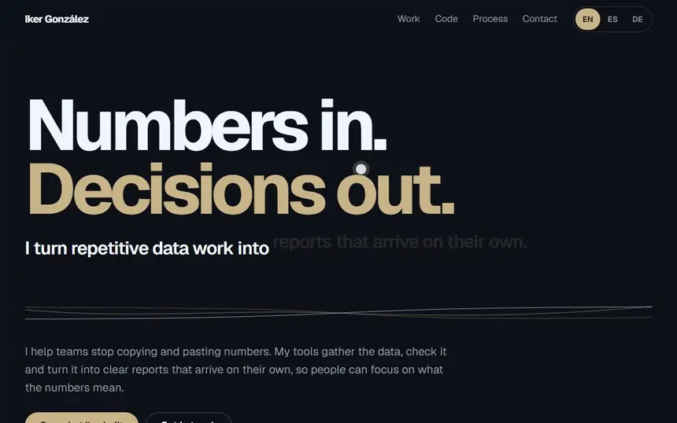

<a href="https://ikertxuletas.github.io"><picture>
  <source media="(prefers-color-scheme: dark)" srcset="assets/hero-dark.svg">
  
</picture></a>

<a href="https://ikertxuletas.github.io"><picture><source media="(prefers-color-scheme: dark)" srcset="assets/link-portfolio-dark.svg"></picture></a>
<a href="https://linkedin.com/in/IkerGRP"><picture><source media="(prefers-color-scheme: dark)" srcset="assets/link-linkedin-dark.svg"></picture></a>
<a href="mailto:iker.g.job@gmail.com"><picture><source media="(prefers-color-scheme: dark)" srcset="assets/link-email-dark.svg"></picture></a>
<a href="https://ikertxuletas.github.io/?lang=es"><picture><source media="(prefers-color-scheme: dark)" srcset="assets/link-es-dark.svg"></picture></a>
<a href="https://ikertxuletas.github.io/?lang=de"><picture><source media="(prefers-color-scheme: dark)" srcset="assets/link-de-dark.svg"></picture></a>

 

<picture>
  <source media="(prefers-color-scheme: dark)" srcset="assets/stats-dark.svg">
  
</picture>

  

<a href="https://ikertxuletas.github.io/#work"><picture>
  <source media="(prefers-color-scheme: dark)" srcset="assets/projects-dark.svg">
  
</picture></a>

<picture><source media="(prefers-color-scheme: dark)" srcset="assets/note-dark.svg"></picture>

<a href="https://github.com/ikertxuletas/job-radar"><picture><source media="(prefers-color-scheme: dark)" srcset="assets/link-jobradar-dark.svg"></picture></a>

  

<a href="https://ikertxuletas.github.io/#stack"><picture>
  <source media="(prefers-color-scheme: dark)" srcset="assets/langs-dark.svg">
  
</picture></a>

  

<picture>
  <source media="(prefers-color-scheme: dark)" srcset="assets/build-dark.svg">
  
</picture>

  

  

<picture>
  <source media="(prefers-color-scheme: dark)" srcset="https://raw.githubusercontent.com/ikertxuletas/ikertxuletas/output/snake-dark.svg">
  
</picture>

  

<a href="mailto:iker.g.job@gmail.com"><picture>
  <source media="(prefers-color-scheme: dark)" srcset="assets/contact-dark.svg">
  
</picture></a>

<a href="mailto:iker.g.job@gmail.com"><picture><source media="(prefers-color-scheme: dark)" srcset="assets/link-email-dark.svg"></picture></a>
<a href="https://linkedin.com/in/IkerGRP"><picture><source media="(prefers-color-scheme: dark)" srcset="assets/link-linkedin-dark.svg"></picture></a>

