### `$ whoami`

Finance and data analyst who automates the work around the numbers. I analysed private equity fund data at **CEPRES** (Munich), worked on damage calculations and reconciliations at **Alvarez & Marsal** and on month-end close at **BDO**. Today I build Python and AI automations with **Claude Code** and **n8n**, for IFEMA's DACH delegation and for small businesses through **Reinike AI**.

My rule: ask what a process costs before automating it, and keep a human check where a mistake would be expensive.

🇪🇸 Spanish native · 🇬🇧 English C1-C2 · 🇩🇪 German B1-B2 · 🕐 CET

### 📈 Portfolio

| Ticker | Project | What it does | Stack | Status |
|:--|:--|:--|:--|:--|
| `RADAR` | [**job-radar**](https://github.com/ikertxuletas/job-radar) | Collects remote job offers every day from public feeds and ~120 company career boards, drops what it already showed, scores each new offer against my profile with an LLM and writes one HTML page. | Python · LLM | 🟢 public |
| `ATLAS` | **Atlas** | Daily market briefing: explains the strong moves in indices, stocks, commodities, FX and rates, then checks days later with data whether the explanation held. Every figure carries its source and date. | Python · JS · LLM | 🔒 private · active |
| `QUANT` | **Quant research desk** | Nightly pipeline that turns published trading strategies into exact rules, backtests them with real broker costs and sends a morning report flagging only the ones that survive. | Python · pytest | 🔒 private · active |
| `FAIRS` | **Trade-fair prospecting suite** | Exhibitor directory scrapers (REST APIs and Playwright), data normalisation, scheduled daily reports and a desktop control centre that monitors every job. | Python · Playwright · PowerShell | 🔒 private · active |
| `LEEME` | **LeeMe** | Desktop app that reads PDFs aloud in a natural Spanish voice and highlights each word as it is spoken. One-click installer. | Python · pywebview · TTS | 🔒 private · active |

Private repos hold client or personal data. Happy to walk you through the code on a call.

### 🧰 Stack

### 🐍 Activity

<picture>
  <source media="(prefers-color-scheme: dark)" srcset="https://raw.githubusercontent.com/ikertxuletas/ikertxuletas/output/snake-dark.svg">
  
</picture>

### 📬 Contact

