<a href="https://ikertxuletas.github.io"><b>Portfolio</b></a>&nbsp;&nbsp;&nbsp;
<a href="https://linkedin.com/in/IkerGRP"><b>LinkedIn</b></a>&nbsp;&nbsp;&nbsp;
<a href="mailto:iker.g.job@gmail.com"><b>iker.g.job@gmail.com</b></a>

  

Open source: <a href="https://github.com/ikertxuletas/job-radar">job-radar</a>. The rest hold personal or client data; happy to show them on a call.

  

  

<picture>
  <source media="(prefers-color-scheme: dark)" srcset="https://raw.githubusercontent.com/ikertxuletas/ikertxuletas/output/snake-dark.svg">
  
</picture>

  

