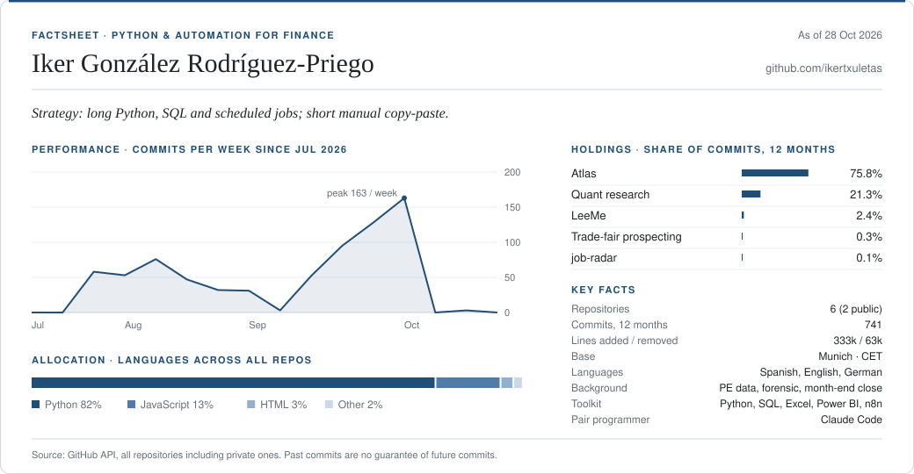
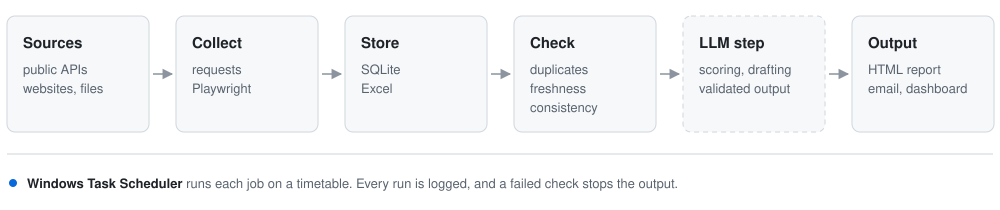

<picture>
  <source media="(prefers-color-scheme: dark)" srcset="assets/card-dark.svg">
  
</picture>

I write Python tools that take repetitive data work off people's hands: scrapers, small pipelines, scheduled reports and the odd desktop app. My background is finance (private equity data, forensic accounting, month-end close), so most of what I build sits close to spreadsheets and numbers. I use Claude Code for most of the typing and spend my own time on the design, the checks and the parts that break.

Based in Munich, working in Spanish, English and German.

#### What I'm working on

- **[job-radar](https://github.com/ikertxuletas/job-radar)**: pulls remote job offers every morning from public job APIs and about 120 company career boards (Greenhouse, Lever, Ashby, Personio and others), drops the ones it has already seen, scores the new ones against a written profile with an LLM and writes a single HTML page.
- **Atlas** (private): a local web app that explains the day's large moves in indices, stocks, commodities, FX and rates, then checks a few days later whether the explanation held up. Every figure is read from one price store and carries its source and closing date; the page is not published if any check fails. Python standard library on the back end, plain ES modules on the front.
- **Quant research** (private): a nightly job that turns published trading strategies into exact rules, backtests them with each broker's real costs and emails a short report in the morning. Around 600 tests, because a backtest that silently lies is worse than none.
- **Trade-fair prospecting** (private): exhibitor scrapers for international trade-fair directories, using the sites' own JSON endpoints where they exist and Playwright where they don't, followed by normalisation, enrichment and a daily report. Runs as scheduled tasks on two machines with a heartbeat, so the second one takes over if the first goes quiet.
- **LeeMe** (private): a Windows app that reads PDFs aloud in a natural Spanish voice and highlights each word as it is spoken (pywebview, edge-tts, VLC).

The private ones hold personal or client data. I'm happy to walk through the code on a call.

#### How most of it is put together

<picture>
  <source media="(prefers-color-scheme: dark)" srcset="assets/pipeline-dark.svg">
  
</picture>

#### Activity

<picture>
  <source media="(prefers-color-scheme: dark)" srcset="https://raw.githubusercontent.com/ikertxuletas/ikertxuletas/output/snake-dark.svg">
  
</picture>

<picture>
  <source media="(prefers-color-scheme: dark)" srcset="https://raw.githubusercontent.com/ikertxuletas/ikertxuletas/output/pacman-contribution-graph-dark.svg">
  
</picture>

<picture>
  <source media="(prefers-color-scheme: dark)" srcset="https://raw.githubusercontent.com/ikertxuletas/ikertxuletas/output/breakout-contribution-graph-dark.svg">
  
</picture>
